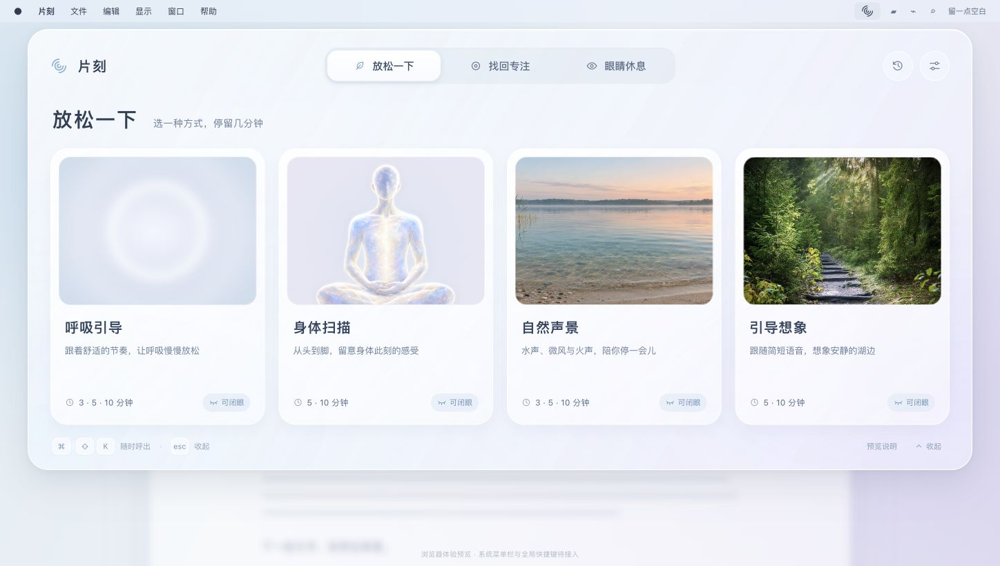

# 片刻 Pianke

**从忙碌里，留一点空白。**

片刻是一款放在 Mac 菜单栏里的休息与专注应用。读累了、工作告一段落，或者想把注意力重新收回来时，点一下水波图标，选一种方式停留几分钟。用完收起，继续手边的事。

**[查看项目演示](https://evenk5838-coder.github.io/pianke-open-source/)** · **[直接体验网页版](https://evenk5838-coder.github.io/pianke-open-source/app/)** · [在 Mac 上运行](#在-mac-上运行)

当前版本：**0.3.6 / build 13 · 体验版**。无需账号或 API Key，固定人声、环境音和图片随 Mac 应用本地保存。



## 可以用它做什么

| 此刻的需要 | 可以选择 | 使用方式 |
| --- | --- | --- |
| 放松一下 | 呼吸引导、身体扫描、自然声景、引导想象 | 跟随声音与画面，停留 3–10 分钟；也可以闭眼聆听 |
| 找回专注 | 视觉聚焦、声音聚焦、舒尔特表、视觉搜索 | 观察、聆听或点击目标；按自己的节奏练习 |
| 眼睛休息 | 眼保健操、组合休息 | 跟随六节按摩示意，或进行眨眼、轻缓眼动与闭眼休息 |

### 跟着呼吸，慢一点

鼻吸 4 秒、口呼 6 秒，水波或烟圈随同一节奏变化。人声带前两轮，之后用高低提示音提醒吸气与呼气。暂停、音量与结束按钮默认隐藏，点击画面再唤出。


### 七种声音，十四处风景

轻水波、细雨、乡野风、岩岸湖水、小溪、海岸与火声，每一种都配有自然和城市 / 室内两张 **AI 静态图片**。可以选雨中的庭院，也可以坐进高层暖光客厅；片刻会记住每类上次选择的画面。进入后切图，声音和计时继续。


### 按自己的习惯使用

- **随时呼出**：Mac 菜单栏水波图标、全局快捷键 `⌘⇧K`；支持沉浸显示和可拖动浮窗。
- **轻柔声音**：48 段 Marin AI 固定引导、7 种实录环境声、4 首氛围配乐；原速播放，人声出现时背景自动降低。
- **三种主题**：极简、雾光玻璃、暮色玻璃，可调整面板透明度和呼吸动效色调。
- **本机保存**：偏好保存在本机；练习记录由你决定是否保存，没有账号或云同步。

[查看完整功能说明与操作方式](docs/FEATURES.md)

## 在 Mac 上运行

需要 **Apple 芯片 Mac、macOS 14 或更新版本、Xcode Command Line Tools**。在终端运行：

```sh
git clone https://github.com/evenk5838-coder/pianke-open-source.git
cd pianke-open-source
zsh outputs/pianke-desktop/build.command
open outputs/片刻.app
```

构建过程采用本地签名，尚未做发行公证。仓库提供可构建源码，没有预先构建的应用安装包。当前没有开机自启功能。

点击菜单栏图标或按 `⌘⇧K` 呼出 / 收起。练习中点击画面显示控制条，空格暂停 / 继续，Esc 可切到浮窗。收起时暂停，再次打开后可手动继续。

## 浏览器体验

[在线打开网页版](https://evenk5838-coder.github.io/pianke-open-source/app/)即可查看界面、选择声音与图片、体验练习。声音在你点击开始后播放。

也可以用 Python 3 在本地预览：

```sh
zsh outputs/pianke/start.command
```

浏览器版展示网页层交互；真正的系统菜单栏、跨应用全局快捷键与桌面浮窗需要 Mac 版本。在线版首次载入需要下载页面及所用素材。截图为应用网页层的真实界面，不是 macOS 原生功能的录屏。

## 0.3.6 更新

新增十四张可选 AI 静态画面，按七种环境声配对；支持每类独立记忆图片选择、会话中换图。运河和雨夜采用最新构图。已有 48 段人声、11 条环境音 / 配乐保持原文件。本轮没有接入场景视频。

## 当前范围

这是持续迭代的个人项目。图片原始尺寸为 1672 × 941；自然声景目前采用静态图，完整听感、长时流畅度与跨设备表现仍需更多体验。技术检查不等于用户体验或健康效果验证。

眼部示意尚未经过专业人员逐图审校；应用不承诺治疗、改善视力、提升注意力或阅读能力。跟随时保持舒服，不需要强迫深呼吸或用力按摩。

## 源码、数据与许可

- `outputs/pianke/`：网页界面、固定人声、环境音、配乐和本地图片。
- `outputs/pianke-desktop/`：AppKit + WKWebView 宿主、桥接及构建脚本。
- `site/`：项目介绍页；演示图片位于 `docs/media/`。
- [PRIVACY.md](PRIVACY.md)：本机偏好、可选练习记录及诊断日志说明。
- [验证范围](outputs/pianke/VERIFICATION.md)：技术检查和未验证事项。
- [素材来源](outputs/pianke/assets/ASSETS.md)、[声音许可](outputs/pianke/assets/audio/LICENSES.md)、[NOTICE.md](NOTICE.md)：素材各自的来源、署名和许可。

代码采用 [MIT](LICENSE)。第三方摄影、环境录音和配乐保留各自的许可；代码的 MIT 许可不会自动覆盖所有素材。固定 AI 录音与场景图保留生成来源说明。仓库不包含 API 密钥、私人版本档案或个人练习记录。
